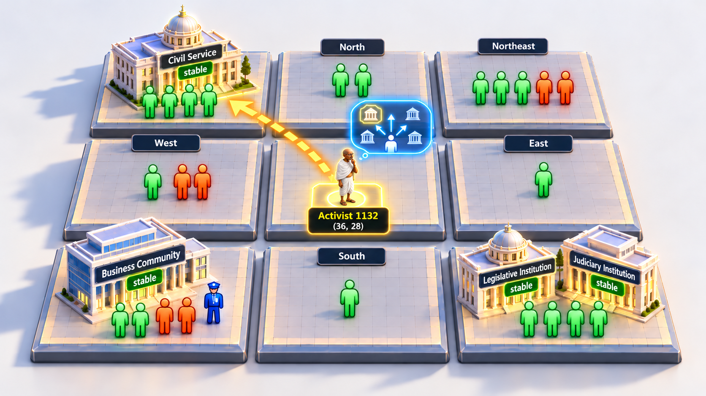
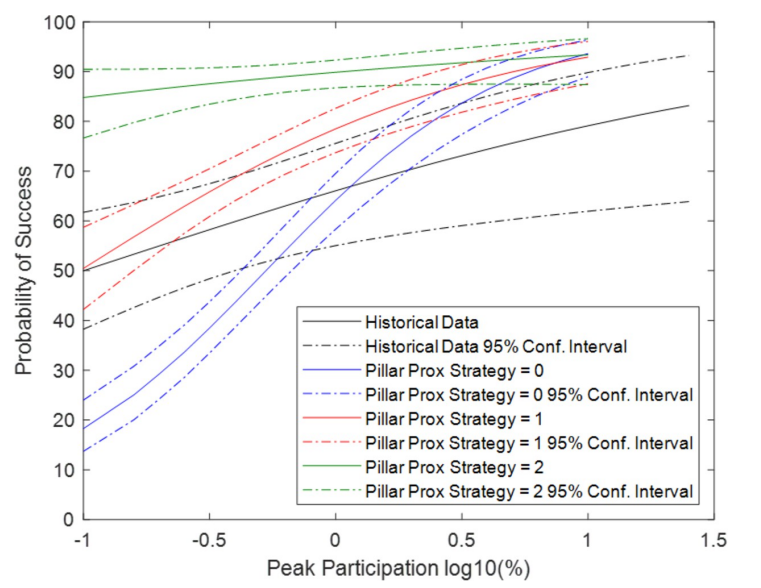
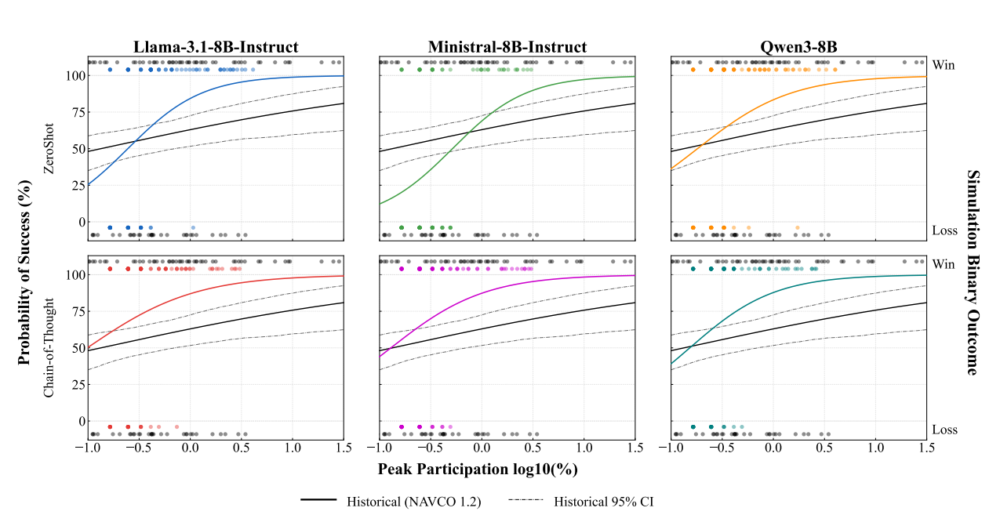

# A Hybrid Generative Agent-Based Model of Nonviolent Resistance

**Activist agents that decide using a language model, inside a rule-based simulation of a nonviolent campaign.**

This project extends the nonviolent resistance agent-based model of Chenoweth, Hocking & Marks (2022). In that model, activists follow fixed if-then rules. Here, activists are controlled by a large language model (LLM) that reasons over what is happening around it, described in words.

---

## Why this model exists

Earlier agent-based models of civil resistance (Epstein → Moro → Chenoweth et al.) use numeric thresholds and deterministic rules for every agent. These models can reproduce whether a campaign succeeds. They cannot show *how* an activist reasons, *why* a movement chooses certain tactics, or *which* institutions it decides to go after. Every regime institution is collapsed into one abstract "pillar", and the only action available is generic protest.

LLM-driven agents ("generative ABMs") can reason in a more human-like way, but they bring three problems:

- **Fidelity:** they drift toward an average persona, or produce fluent output that contradicts the context they were given.
- **Validation:** a stochastic black box inside a simulation is hard to validate.
- **Cost:** making every agent an LLM call is expensive and slow.

This project is designed around those three problems.

## Core ideas

### 1. Decisions based on context instead of thresholds

The rule-based activist moves to the cell closest to the pillar with the lowest defection threshold, which is a number no real activist could ever see. The LLM activist instead gets a written description of its neighbourhood and of its recent past, and picks a move for strategic reasons:

| Rule-based activist (baseline) | LLM-enabled activist (this model) |
|---|---|
| `move to argmin(defectThreshold)` | "The judiciary is still loyal to the regime, suffering citizens are gathering to the north-east, and police were active to the south last step…" |
| Sees numbers | Sees social descriptors |
| One action: protest | Picks a **target group**, a **pillar institution**, a **Gandhian attribute**, and a **nonviolent method** (protest & persuasion / non-cooperation / intervention) |
| No memory | Short-term memory: what it did and what it saw at step *t−1* |

To make this possible, a **linguistic transformation layer** turns the simulation's numeric state into words the LLM can reason about:

| Simulation state | What the LLM sees |
|---|---|
| Citizen grievance ∈ [0, 1] (relative split, recomputed every step) | `suffering` (top ~34%) / `unbothered` (rest) |
| Citizen / activist flags | `active_nonviolent`, `protesting`, `jailed`, `killed` |
| Police defection flag | `active` / `defected` |
| Pillar defection flag + institution type | e.g. `stable: ["Judiciary Institution"]`, `defected: ["Civil Service"]` |
| Grid geometry (toroidal) | Grouped by compass direction (N, NE, …, adjacent), with an explicit `can_move_to` list of valid cells |
| Event log from step *t−1* | Narrative memory, e.g. *"1 resistance member arrested nearby. Fear spreads, so does outrage. Judiciary Institution defected. Law recoils from injustice."* |

The memory narratives are built from **deterministic text templates**, not extra LLM calls, so memory adds no inference cost.

<p align="center">
  
</p>

*How an activist sees its surroundings. The neighbourhood is split into compass zones. Each zone shows the citizens (green = suffering, orange = unbothered), police, and pillar institutions in it, along with their status. The LLM weighs these zones and picks a move, here toward the stable Civil Service.*

### 2. Eight concrete pillars instead of one abstract pillar

Following the CANVAS curriculum and Gene Sharp's six sources of power, the single pillar class is replaced by eight institution types. The LLM can reason about what each one does for the regime:

> Educational System · Religious Institution · Business Community · State-Supported Media · Civil Service · Judiciary Institution · Legislative Institution · Local Government

The types are split evenly across the 24 pillar agents (3 each), shuffled, and assigned **independently of the defection threshold**. The label only affects how the LLM reasons. Defection is still decided by the baseline rule (`protesters / neighbours > D`), so no institution is easier to flip by construction.

### 3. Hybrid design: only the activists use the LLM

Only the **activist** class (0.8% of the grid, about 13 agents) calls the LLM. Citizens, police, and pillars (more than 1,200 agents) stay rule-based.

- **Cost:** activists lead campaigns, so they are where reasoning matters most, and they are few, so the number of LLM calls per step stays small.
- **Validation:** grievance dynamics, repression, citizen participation, and defection all follow the published, calibrated baseline rules. The LLM only decides activist movement and intent, so any change in outcomes can be traced back to that one decision.
- **Fidelity:** a four-part system prompt (**role, persona, world knowledge, scenario**) gives every activist the same fixed identity, which limits behavioural drift over a 200-step run.

```
                ┌──────────────────────── Mesa ABM (rule-based) ────────────────────────┐
                │  Citizens (Rule C, NV)   Police (Rule P, D)   Pillars ×8 types (Rule D) │
                └───────────────┬───────────────────────────────────────▲──────────────┘
                     numeric state + event log                     chosen cell
                                │                                       │
                    ┌───────────▼────────────┐               ┌──────────┴──────────┐
                    │ Linguistic transform   │               │ Pydantic validation │
                    │  · directional context │               │ retry → rule fallback│
                    │  · template memory     │               └──────────▲──────────┘
                    └───────────┬────────────┘                          │ JSON
                                │  system prompt (role/persona/world/scenario)
                                └──────────────►  LLM activist  ────────┘
                                   + user prompt (memory/context/task)
```

---

## The decision loop at each step

1. **Log → memory.** The previous step's event log is filtered to the events within each activist's vision radius (using toroidal distance) and turned into two narratives: a *self-reflection* on its own last action and a list of *recent events* it witnessed.
2. **State → context.** The activist's neighbourhood is grouped by direction. Each agent's state is replaced by its social descriptor, and only the free cells it can reach are listed.
3. **Prompt.** A fixed system prompt (role, persona, world knowledge, scenario) is combined with a user prompt that fills `{{SELF_REFLECTION}}`, `{{RECENT_EVENTS}}`, and `{{ACTIVIST_LOCAL_CONTEXT}}`.
4. **Decide.** The LLM returns a JSON decision. With **Zero-Shot** prompting it returns the decision directly. With **Chain-of-Thought** prompting it first writes an observation and a strategic intent.
5. **Validate and act.** The output is checked against Pydantic schemas. An invalid position triggers a retry with the error message, and repeated failure falls back to rule-based movement. The activist moves, and its decision is written to the event log, where it becomes the next step's memory.
6. **Rule-based world.** Citizens, police, and pillars then act according to the baseline rules (grievance, peer pressure, arrest and kill, defection thresholds).

```json
{
  "reasoning": {
    "observation": "A stable Judiciary Institution is to the north-east with suffering citizens nearby.",
    "strategic_intent": "Moving toward the judiciary with protesters nearby can pull it away from the regime."
  },
  "decision": {
    "chosen_position": [12, 7],
    "target_agent_group": "pillars",
    "target_pillar_institution": "Judiciary Institution",
    "primary_attribute": "Courage",
    "non_violent_action_method": "protest_and_persuasion"
  }
}
```

## Evaluating the model

The logs support evaluation at two levels:

- **Macro level (campaign outcomes):** for each run, compute peak participation (the maximum share of protesting citizens and activists) and the outcome (resistance win, regime win, or timeout). Fit a logistic regression of success on log₁₀(peak participation) and compare the curve with the NAVCO 1.2 historical campaigns ([Analysis/probablity_win_analysis.py](Analysis/probablity_win_analysis.py)).
- **Micro level (activist behaviour):** from the logged decisions, measure:
  - the **approach rate** of each institution: how often activists move toward it when it is visible
  - the **defection share** of each institution: what fraction of all defections it accounts for
  - the use of **nonviolent methods**, both per campaign and per decision, compared with the Global Nonviolent Action Database
  - the **target mix** across citizens, pillars, police, and activists
  - campaign-level measures such as activist coordination and fatality

The same pipeline works for any LLM and either prompting method, so results can be compared across models and prompting methods.

### Rule-based strategies vs. LLM-guided activists

The baseline model has three rule-based activist strategies (`PillarProxStrat`):

- **0, Random:** move to a random free cell.
- **1, Nearest pillar:** move toward the closest visible pillar.
- **2, Weakest pillar:** use extended vision to find the pillar with the **lowest defection threshold** and move toward it.

Strategy 2 gives the highest success rates in the baseline model. It also depends on something no real activist has: it reads each pillar's internal loyalty threshold directly.

LLM-guided activists never see that threshold. They only see an institution's type (e.g. Judiciary, Civil Service) and whether it is still `stable` or has `defected`, and they decide which pillar to approach based on what each institution does for the regime.

<p align="center">
  
</p>

*Rule-based activist strategies of the baseline model (Chenoweth et al., 2022): success probability against log₁₀ peak participation, compared with historical data.*

<p align="center">
  
</p>

*LLM-guided activists (strategy 3): three open-weight LLMs under Zero-Shot and Chain-of-Thought prompting, 100 runs each, compared with NAVCO 1.2. Dots show the win or loss of individual runs.*

Above about 1% peak participation (log₁₀ ≥ 0), the LLM-guided curves reach the same high success levels as the weakest-pillar strategy (around 90% and above). The LLM activists get there by reasoning over observable, institution-level information, without being given the regime's hidden loyalty values. At the lowest participation levels, their curves start lower, closer to the random and nearest-pillar strategies and to the historical baseline.

---

## Repository layout

```
├── resistance_model.py       NVResistanceModel: grid, schedule, grievance labels, pillar assignment, victory
├── agent_based.py            Citizen / Activist / Police / Pillar agents; builds the LLM's directional context
├── run_simulation.py         RunOrchestrator + BASE_PARAMS: N isolated runs, batch summary
├── run_cluster.py            CLI entry point used by the SLURM scripts
├── non_voilent.ipynb         Interactive notebook (live grid visualisation, batch runs)
│
├── LLM/
│   ├── chat_model.py         build_provider() factory + ChatModel wrapper
│   ├── base.py               Prompt rendering, output validation, retry
│   ├── schemas.py            Pydantic output schemas; pillar types and weights
│   ├── raw_memory.py         Step event log → per-activist observations (within vision, toroidal)
│   ├── nlp_memory.py         Observations → narrative memory (self-reflection, recent events)
│   └── providers/            vllm_provider (main), huggingface, gemini, openai_provider, ollama
│
├── Prompts/
│   ├── ZeroShot/             system_prompt.md, user_prompt_w_memory.md, user_prompt_wo_memory.md
│   └── CoT/                  same, plus a "reasoning" block (observation, strategic_intent)
│
├── Logging/                  LogConfig (all output paths) + pickle-safe SimLogger
├── Analysis/                 Log notebooks; success-probability vs. NAVCO script
└── slurm/                    HPC setup and job scripts (vLLM server + simulation)
```

The repository also contains some exploratory code and files that the main pipeline does not use.

---

## Getting started

### Install

```bash
git clone https://github.com/mahnoor-khalid9/abm_llm_nonviolence.git
cd abm_llm_nonviolence
python -m venv .venv && source .venv/bin/activate
pip install -r requirements.txt     # vllm/transformers/bitsandbytes need a CUDA GPU
```

### Run with a local vLLM server

Open-weight models served locally keep runs reproducible and avoid per-call API costs.

```bash
# 1. Serve an open-weight model (OpenAI-compatible API)
python -m vllm.entrypoints.openai.api_server \
    --model meta-llama/Llama-3.1-8B-Instruct \
    --max-model-len 4096 --max-num-seqs 25 \
    --gpu-memory-utilization 0.90 --enable-prefix-caching --port 8000

# 2. Run 100 simulations, 25 in parallel
python run_cluster.py --provider vllm --prompt_type CoT \
    --n_runs 100 --start_run 0 --max_workers 25 --output_dir SimulationLogs
```

The vLLM provider finds the server on ports 8000–8020 and reads the served model name automatically. Decoding uses `temperature=0.0`, so all run-to-run variation comes from the ABM's own randomness. For reasoning models such as Qwen3, the provider sends `enable_thinking=False` so that Zero-Shot and CoT stay comparable. Because every activist shares the same system prompt, prefix caching reuses it across calls.

| Flag | Default | Description |
|---|---|---|
| `--provider` | `vllm` | `vllm`, `huggingface`, `gemini`, `openai` |
| `--prompt_type` | `CoT` | `ZeroShot` or `CoT` |
| `--n_runs` / `--start_run` | `10` / `0` | Number of runs and first run id (use `--start_run` to resume) |
| `--max_workers` | `10` | Simulations run concurrently; vLLM batches their requests |
| `--max_steps` | `200` | Steps per run |
| `--pillar_strat` | `3` | Activist strategy: `0` random, `1` nearest pillar, `2` weakest pillar (baseline rules), `3`/`4` LLM-guided (normal / extended vision) |

### Run from Python or the notebook

```python
from Logging.log_config import LogConfig
from run_simulation import RunOrchestrator, BASE_PARAMS

cfg  = LogConfig(provider="vllm", prompt_type="ZeroShot", memory="stateful",
                 vision="vision-4", base_dir="SimulationLogs")
orch = RunOrchestrator(base_config=cfg, params={**BASE_PARAMS, "PillarProxStrat": 3},
                       max_workers=4)
orch.run(n_runs=10)
```

`LogConfig.provider` selects the LLM backend and is also part of the output path. [non_voilent.ipynb](non_voilent.ipynb) has an interactive grid view that shows each pillar with its institution symbol.

### On an HPC cluster (SLURM)

```bash
sbatch slurm/submit_setup.slurm     # one-time: venv, dependencies, model download
sbatch slurm/run_unity_8B.slurm     # starts vLLM, waits for it, runs run_cluster.py, shuts down
```

Edit the paths and the `MODEL_PATH` / `PROMPT_TYPE` / `N_RUNS` settings at the top of each script before running.

---

## Output

Each configuration writes to `SimulationLogs/<provider>/<prompt_type>/<memory>/<vision>/`:

- `batch_summary_*.json`: outcome, number of steps, and duration for each run
- `AgentsLogging/simulation_log/…/step_<n>.txt`: every agent event per step, including each LLM decision
- `AgentsLogging/memory_log/{raw_json,nlp_json}/…`: parsed observations and the narrative memory sent to the LLM
- `ModelLogging/…/model_simulation_log_v<run>.txt`: model state per step (legitimacy, counts, defected institutions, grievance split)

## Extending

- **Another LLM:** subclass `BaseProvider`, implement `_call_api()`, and register it in `build_provider()` ([LLM/README.md](LLM/README.md)).
- **Another prompting method:** add a folder under `Prompts/`, add a matching output schema, and pass its name as `prompt_type`.
- **Another persona or leadership style:** edit the role and persona sections of the system prompt. The rest of the pipeline stays the same.
- **More reasoning agents:** the same context and memory layers can be reused to make pillars or police LLM-driven, so the regime side also reasons.

## References

- Chenoweth, E., Hocking, A., & Marks, Z. (2022). A dynamic model of nonviolent resistance strategy. *PLOS ONE*, 17(7): e0269976.
- Chenoweth, E., & Stephan, M. J. (2011). *Why Civil Resistance Works.* Columbia University Press.
- Chenoweth, E., & Shay, C. W. (2019). NAVCO 1.2 Dataset. Harvard Dataverse.
- Swarthmore College. Global Nonviolent Action Database. https://nvdatabase.swarthmore.edu/
- Sharp, G. (1973). *The Politics of Nonviolent Action.* Porter Sargent.
- CANVAS (2007). *CANVAS Core Curriculum: A Guide to Effective Nonviolent Struggle.*
